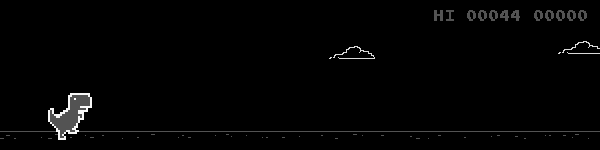
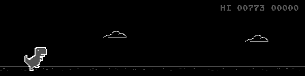

# DinoRL

**Author:** Dong Wuzheng

Copyright (c) 2026 Dong Wuzheng. All rights reserved until December 1, 2026; the project is planned to be released under the MIT License after that date.

A compact reinforcement-learning project for the Chrome T-Rex Runner. The notebook runs the local game in Firefox, loads the included PyTorch policy, evaluates it, and renders a gameplay GIF inline.

## Quick start

1. Install Python 3.10+ and Firefox.
2. Install dependencies:
   ```bash
   pip install -r requirements.txt
   ```
3. Open [`dinorl.ipynb`](dinorl.ipynb) from the repository root in Jupyter and run its cells from top to bottom.

If geckodriver is not already on `PATH`, Selenium Manager locates or downloads a matching driver on first browser launch.

## Training progress

These GIFs show three saved gameplay examples from the policy at different training stages.

### Early training — `123.gif`



### Mid-training — `5716.gif`


### Final policy — `dino_score_2191.gif`



## Repository files

- [`dinorl.ipynb`](dinorl.ipynb): game wrapper, DQN model, optional in-memory training, evaluation, and inline demo.
- [`dino_model.pt`](dino_model.pt): supplied pretrained PyTorch checkpoint.
- [`t-rex-runner-gh-pages/`](t-rex-runner-gh-pages/): the game page, controller, license, and required offline sprite sheets.
- [`requirements.txt`](requirements.txt): Python dependencies.
- [`results/`](results/): the three gameplay GIFs shown above.

Training is disabled by default. Set `RUN_TRAINING = True` in the first code cell to run the 120-second experiment. Training updates stay in memory and do not overwrite or save to `dino_model.pt`; evaluation and the demo load the supplied checkpoint.

The bundled T-Rex Runner files retain their original BSD 3-Clause license in `t-rex-runner-gh-pages/LICENSE`.
